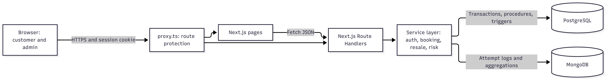
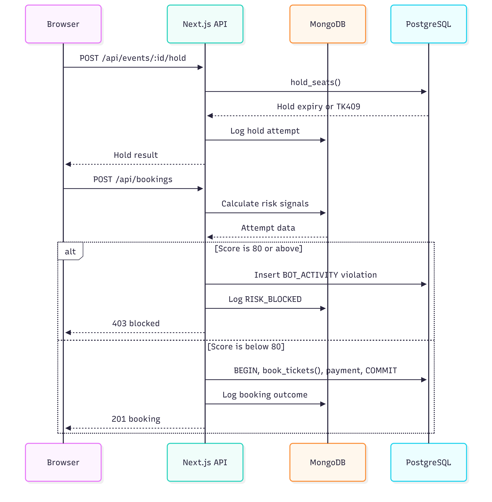

# Digital Event Ticket Reservation & Anti-Scalping Engine: Design Document

**Team:** Sujay P Nayak and Sohan MR

## 1. Overall system architecture

The app has one Next.js codebase and two databases. Browsers only talk to Next.js, and Next.js is the only part that talks to the databases.



| Layer | Responsibility |
|---|---|
| **Frontend** | Login, event search, seat map, checkout, tickets, resale, admin dashboard |
| **`proxy.ts`** | Redirects logged-out users and blocks non-admins from admin routes |
| **Route Handlers** | Validate input, check the session and role, and return JSON |
| **Service layer** | Connects to both databases and calculates the risk score |
| **PostgreSQL** | Stores users, seats, bookings, payments, tickets and resale data, and enforces the rules |
| **MongoDB** | Stores high-volume purchase attempts for fraud detection |

Route Handlers must check permissions themselves too, so a mistake in `proxy.ts` can't expose an API.

## 2. Final ER diagram

There are 15 PostgreSQL tables.


## 3. Complete database schema

```sql
CREATE EXTENSION IF NOT EXISTS pgcrypto;

-- SECTION A: Sujay
CREATE TABLE roles (
  role_id INT GENERATED ALWAYS AS IDENTITY PRIMARY KEY,
  name VARCHAR(20) NOT NULL UNIQUE CHECK (name IN ('CUSTOMER', 'ADMIN', 'STAFF'))
);

CREATE TABLE users (
  user_id INT GENERATED ALWAYS AS IDENTITY PRIMARY KEY,
  role_id INT NOT NULL REFERENCES roles(role_id),
  full_name VARCHAR(100) NOT NULL,
  email VARCHAR(255) NOT NULL UNIQUE CHECK (email = lower(email)),
  password_hash TEXT NOT NULL,
  is_banned BOOLEAN NOT NULL DEFAULT FALSE,
  created_at TIMESTAMPTZ NOT NULL DEFAULT now()
);

CREATE TABLE venues (
  venue_id INT GENERATED ALWAYS AS IDENTITY PRIMARY KEY,
  name VARCHAR(120) NOT NULL,
  city VARCHAR(80) NOT NULL,
  address TEXT NOT NULL,
  UNIQUE (name, city)
);

CREATE TABLE events (
  event_id INT GENERATED ALWAYS AS IDENTITY PRIMARY KEY,
  venue_id INT NOT NULL REFERENCES venues(venue_id),
  organizer_id INT NOT NULL REFERENCES users(user_id),
  title VARCHAR(150) NOT NULL,
  description TEXT,
  starts_at TIMESTAMPTZ NOT NULL,
  status VARCHAR(20) NOT NULL DEFAULT 'DRAFT'
    CHECK (status IN ('DRAFT', 'PUBLISHED', 'CANCELLED', 'COMPLETED')),
  created_at TIMESTAMPTZ NOT NULL DEFAULT now()
);

CREATE TABLE seat_categories (
  category_id INT GENERATED ALWAYS AS IDENTITY PRIMARY KEY,
  event_id INT NOT NULL REFERENCES events(event_id) ON DELETE CASCADE,
  name VARCHAR(50) NOT NULL,
  price NUMERIC(10, 2) NOT NULL CHECK (price >= 0),
  UNIQUE (event_id, name),
  UNIQUE (category_id, event_id)
);

CREATE TABLE seats (
  seat_id INT GENERATED ALWAYS AS IDENTITY PRIMARY KEY,
  event_id INT NOT NULL,
  category_id INT NOT NULL,
  row_label VARCHAR(5) NOT NULL,
  seat_number INT NOT NULL CHECK (seat_number > 0),
  status VARCHAR(20) NOT NULL DEFAULT 'AVAILABLE'
    CHECK (status IN ('AVAILABLE', 'HELD', 'BOOKED')),
  held_by INT REFERENCES users(user_id),
  hold_expires_at TIMESTAMPTZ,
  UNIQUE (event_id, row_label, seat_number),
  FOREIGN KEY (category_id, event_id)
    REFERENCES seat_categories(category_id, event_id) ON DELETE CASCADE,
  CHECK ((status = 'HELD') = (held_by IS NOT NULL AND hold_expires_at IS NOT NULL))
);

CREATE TABLE bookings (
  booking_id INT GENERATED ALWAYS AS IDENTITY PRIMARY KEY,
  user_id INT NOT NULL REFERENCES users(user_id),
  event_id INT NOT NULL REFERENCES events(event_id),
  status VARCHAR(20) NOT NULL DEFAULT 'CONFIRMED'
    CHECK (status IN ('CONFIRMED', 'CANCELLED')),
  created_at TIMESTAMPTZ NOT NULL DEFAULT now()
);

CREATE TABLE tickets (
  ticket_id INT GENERATED ALWAYS AS IDENTITY PRIMARY KEY,
  booking_id INT NOT NULL REFERENCES bookings(booking_id),
  seat_id INT NOT NULL REFERENCES seats(seat_id),
  owner_id INT NOT NULL REFERENCES users(user_id),
  face_value NUMERIC(10, 2) NOT NULL CHECK (face_value >= 0),
  ticket_code UUID NOT NULL UNIQUE DEFAULT gen_random_uuid(),
  status VARCHAR(20) NOT NULL DEFAULT 'VALID'
    CHECK (status IN ('VALID', 'USED', 'CANCELLED')),
  issued_at TIMESTAMPTZ NOT NULL DEFAULT now()
);

-- SECTION B: Sohan
CREATE TABLE purchase_limits (
  limit_id INT GENERATED ALWAYS AS IDENTITY PRIMARY KEY,
  event_id INT NOT NULL UNIQUE REFERENCES events(event_id) ON DELETE CASCADE,
  max_tickets_per_user INT NOT NULL DEFAULT 4 CHECK (max_tickets_per_user > 0),
  max_transfers_per_ticket INT NOT NULL DEFAULT 2 CHECK (max_transfers_per_ticket >= 0),
  resale_cap_percent NUMERIC(5, 2) NOT NULL DEFAULT 110 CHECK (resale_cap_percent >= 100),
  resale_cutoff_hours INT NOT NULL DEFAULT 24 CHECK (resale_cutoff_hours >= 0)
);

CREATE TABLE resale_listings (
  listing_id INT GENERATED ALWAYS AS IDENTITY PRIMARY KEY,
  ticket_id INT NOT NULL REFERENCES tickets(ticket_id),
  seller_id INT NOT NULL REFERENCES users(user_id),
  ask_price NUMERIC(10, 2) NOT NULL CHECK (ask_price > 0),
  status VARCHAR(20) NOT NULL DEFAULT 'ACTIVE'
    CHECK (status IN ('ACTIVE', 'SOLD', 'CANCELLED')),
  listed_at TIMESTAMPTZ NOT NULL DEFAULT now(),
  closed_at TIMESTAMPTZ,
  CHECK ((status = 'ACTIVE') = (closed_at IS NULL))
);

CREATE TABLE ticket_transfers (
  transfer_id INT GENERATED ALWAYS AS IDENTITY PRIMARY KEY,
  ticket_id INT NOT NULL REFERENCES tickets(ticket_id),
  from_user_id INT NOT NULL REFERENCES users(user_id),
  to_user_id INT NOT NULL REFERENCES users(user_id),
  listing_id INT UNIQUE REFERENCES resale_listings(listing_id),
  transferred_at TIMESTAMPTZ NOT NULL DEFAULT now(),
  CHECK (from_user_id <> to_user_id)
);

-- SECTION C: shared
CREATE TABLE payments (
  payment_id INT GENERATED ALWAYS AS IDENTITY PRIMARY KEY,
  booking_id INT UNIQUE REFERENCES bookings(booking_id),
  listing_id INT UNIQUE REFERENCES resale_listings(listing_id),
  amount NUMERIC(10, 2) NOT NULL CHECK (amount >= 0),
  method VARCHAR(20) NOT NULL CHECK (method IN ('UPI', 'CARD', 'NETBANKING')),
  status VARCHAR(20) NOT NULL DEFAULT 'SUCCESS'
    CHECK (status IN ('SUCCESS', 'REFUNDED')),
  transaction_ref VARCHAR(80) NOT NULL UNIQUE,
  paid_at TIMESTAMPTZ NOT NULL DEFAULT now(),
  CHECK (num_nonnulls(booking_id, listing_id) = 1)
);

-- SECTION D: Sohan
CREATE TABLE violations (
  violation_id INT GENERATED ALWAYS AS IDENTITY PRIMARY KEY,
  user_id INT NOT NULL REFERENCES users(user_id),
  event_id INT REFERENCES events(event_id),
  violation_type VARCHAR(30) NOT NULL
    CHECK (violation_type IN ('TICKET_LIMIT', 'RESALE_PRICE', 'TRANSFER_RULE', 'BOT_ACTIVITY')),
  details TEXT,
  created_at TIMESTAMPTZ NOT NULL DEFAULT now()
);

CREATE TABLE flagged_accounts (
  flag_id INT GENERATED ALWAYS AS IDENTITY PRIMARY KEY,
  user_id INT NOT NULL REFERENCES users(user_id),
  reason TEXT NOT NULL,
  risk_score INT CHECK (risk_score BETWEEN 0 AND 100),
  status VARCHAR(20) NOT NULL DEFAULT 'OPEN'
    CHECK (status IN ('OPEN', 'CLEARED', 'BANNED')),
  flagged_at TIMESTAMPTZ NOT NULL DEFAULT now(),
  reviewed_by INT REFERENCES users(user_id),
  reviewed_at TIMESTAMPTZ,
  CHECK ((status = 'OPEN') = (reviewed_by IS NULL)),
  CHECK ((status = 'OPEN') = (reviewed_at IS NULL))
);

CREATE TABLE waitlist (
  waitlist_id INT GENERATED ALWAYS AS IDENTITY PRIMARY KEY,
  event_id INT NOT NULL REFERENCES events(event_id) ON DELETE CASCADE,
  user_id INT NOT NULL REFERENCES users(user_id),
  status VARCHAR(20) NOT NULL DEFAULT 'WAITING'
    CHECK (status IN ('WAITING', 'NOTIFIED', 'BOOKED', 'EXPIRED')),
  joined_at TIMESTAMPTZ NOT NULL DEFAULT now(),
  UNIQUE (event_id, user_id)
);

-- INDEXES
CREATE INDEX idx_seats_event_status ON seats (event_id, status);
CREATE INDEX idx_events_starts_at ON events (starts_at);
CREATE INDEX idx_events_title_fts ON events USING GIN (to_tsvector('english', title));
CREATE INDEX idx_bookings_user ON bookings (user_id);
CREATE INDEX idx_tickets_owner ON tickets (owner_id);
CREATE INDEX idx_tickets_booking ON tickets (booking_id);
CREATE INDEX idx_resale_status ON resale_listings (status);
CREATE INDEX idx_transfers_ticket ON ticket_transfers (ticket_id);
CREATE INDEX idx_violations_user ON violations (user_id);

CREATE UNIQUE INDEX uq_valid_ticket_per_seat
  ON tickets (seat_id) WHERE status = 'VALID';
CREATE UNIQUE INDEX uq_active_listing_per_ticket
  ON resale_listings (ticket_id) WHERE status = 'ACTIVE';
CREATE UNIQUE INDEX uq_open_flag_per_user
  ON flagged_accounts (user_id) WHERE status = 'OPEN';

-- VIEWS
CREATE VIEW v_event_availability AS
SELECT e.event_id, e.title, e.description, e.starts_at, e.status,
       v.name AS venue, v.city,
       COUNT(s.seat_id) AS total_seats,
       COUNT(s.seat_id) FILTER (
         WHERE s.status = 'AVAILABLE'
            OR (s.status = 'HELD' AND s.hold_expires_at <= now())
       ) AS available_seats,
       MIN(c.price) AS min_price
FROM events e
JOIN venues v ON v.venue_id = e.venue_id
LEFT JOIN seats s ON s.event_id = e.event_id
LEFT JOIN seat_categories c ON c.category_id = s.category_id
GROUP BY e.event_id, v.venue_id;

CREATE VIEW v_flagged_users AS
SELECT f.flag_id, u.user_id, u.full_name, u.email, u.is_banned,
       f.reason, f.risk_score, f.status, f.flagged_at,
       (SELECT COUNT(*) FROM violations x WHERE x.user_id = u.user_id) AS violation_count
FROM flagged_accounts f
JOIN users u ON u.user_id = f.user_id;

CREATE VIEW v_resale_report AS
SELECT l.listing_id, e.event_id, e.title, t.ticket_id, t.face_value, l.ask_price,
       ROUND((l.ask_price / NULLIF(t.face_value, 0) - 1) * 100, 2) AS markup_percent,
       l.status, u.full_name AS seller, l.listed_at
FROM resale_listings l
JOIN tickets t ON t.ticket_id = l.ticket_id
JOIN bookings b ON b.booking_id = t.booking_id
JOIN events e ON e.event_id = b.event_id
JOIN users u ON u.user_id = l.seller_id;
```

### Rules enforced by procedures and triggers

| Object | Type | Rule | Error code |
|---|---|---|---|
| `hold_seats()` | Function | Holds every requested seat for 5 minutes, or none of them | `TK409` |
| `book_tickets()` | Procedure | Turns the user's valid hold into a booking and tickets | `TK409` |
| `buy_resale()` | Procedure | Locks the listing, then records the sale and new ticket owner in one transaction | `TK409` |
| `trg_ticket_limit` | Trigger | Blocks more than the event's ticket limit per user | `TK421` |
| `trg_resale_price` | Trigger | Blocks listings above face value × `resale_cap_percent / 100` | `TK422` |
| `trg_transfer_rules` | Trigger | Blocks transfers after the cutoff or above the transfer limit | `TK423` |
| `trg_flag_on_violation` | Trigger | Opens a flag when a user reaches 3 violations | None |

If an event has no `purchase_limits` row, the triggers use the default values shown in that table.

## 4. Normalization to 3NF

### First normal form

- Each column holds one value. For example, a booking's seats are stored as separate `tickets` rows rather than a seat list.
- Each table has a primary key, and there are no repeating groups.

### Second normal form

Every table uses a single-column primary key, so a column can't depend on only part of the primary key.

### Third normal form

| Problem avoided | Bad design | Final design |
|---|---|---|
| Role name repeated for users | `users(role_name)` | `users.role_id` → `roles` |
| Venue details repeated for events | `events(venue_city, venue_address)` | `events.venue_id` → `venues` |
| Price repeated for seats | `seats(price)` | `seats.category_id` → `seat_categories` |
| Stored booking total | `bookings(total_amount)` | Calculate it from `tickets`, and store the paid amount in `payments` |
| Event repeated on tickets | `tickets(event_id)` | `tickets.booking_id` → `bookings.event_id` |
| Sale price repeated on transfers | `ticket_transfers(price)` | `ticket_transfers.listing_id` → `resale_listings.ask_price` |

### Columns to explain in the viva

- **`seats.event_id`:** `category_id` also determines the event, but this still satisfies 3NF because `event_id` is part of the candidate key `(event_id, row_label, seat_number)`. The composite foreign key keeps the two values consistent.
- **`tickets.face_value`:** this records the price at purchase, so it won't change if a category price changes later.
- **`payments.amount`:** this records the amount actually paid.
- **`resale_listings.seller_id`:** this records who listed the ticket, even after the ticket's owner changes.

## 5. Data dictionary

Columns are required unless marked optional. `PK` means primary key, `FK` means foreign key, and `UQ` means unique.

### PostgreSQL tables

#### `roles`

| Column | Type | Key | Description |
|---|---|---|---|
| `role_id` | `INT` | PK | Role ID |
| `name` | `VARCHAR(20)` | UQ | `CUSTOMER`, `ADMIN` or `STAFF` |

#### `users`

| Column | Type | Key | Description |
|---|---|---|---|
| `user_id` | `INT` | PK | User ID |
| `role_id` | `INT` | FK | User's role |
| `full_name` | `VARCHAR(100)` | | Display name |
| `email` | `VARCHAR(255)` | UQ | Lowercase login email |
| `password_hash` | `TEXT` | | Bcrypt hash |
| `is_banned` | `BOOLEAN` | | Whether the user is banned now |
| `created_at` | `TIMESTAMPTZ` | | Registration time |

#### `venues`

| Column | Type | Key | Description |
|---|---|---|---|
| `venue_id` | `INT` | PK | Venue ID |
| `name` | `VARCHAR(120)` | UQ with `city` | Venue name |
| `city` | `VARCHAR(80)` | UQ with `name` | Venue city |
| `address` | `TEXT` | | Street address |

#### `events`

| Column | Type | Key | Description |
|---|---|---|---|
| `event_id` | `INT` | PK | Event ID |
| `venue_id` | `INT` | FK | Event venue |
| `organizer_id` | `INT` | FK | User who created the event |
| `title` | `VARCHAR(150)` | | Event title |
| `description` | `TEXT` | Optional | Event details |
| `starts_at` | `TIMESTAMPTZ` | | Start time |
| `status` | `VARCHAR(20)` | | `DRAFT`, `PUBLISHED`, `CANCELLED` or `COMPLETED` |
| `created_at` | `TIMESTAMPTZ` | | Creation time |

#### `seat_categories`

| Column | Type | Key | Description |
|---|---|---|---|
| `category_id` | `INT` | PK | Category ID |
| `event_id` | `INT` | FK | Event offering this category |
| `name` | `VARCHAR(50)` | UQ with `event_id` | Category name, such as VIP |
| `price` | `NUMERIC(10,2)` | | Current price in rupees |

#### `seats`

| Column | Type | Key | Description |
|---|---|---|---|
| `seat_id` | `INT` | PK | Seat ID |
| `event_id` | `INT` | FK, UQ part | Event the seat belongs to |
| `category_id` | `INT` | FK | Seat category |
| `row_label` | `VARCHAR(5)` | UQ part | Row label |
| `seat_number` | `INT` | UQ part | Seat number in the row |
| `status` | `VARCHAR(20)` | | `AVAILABLE`, `HELD` or `BOOKED` |
| `held_by` | `INT` | FK, optional | User holding the seat |
| `hold_expires_at` | `TIMESTAMPTZ` | Optional | Time the hold expires |

#### `bookings`

| Column | Type | Key | Description |
|---|---|---|---|
| `booking_id` | `INT` | PK | Booking ID |
| `user_id` | `INT` | FK | Original buyer |
| `event_id` | `INT` | FK | Booked event |
| `status` | `VARCHAR(20)` | | `CONFIRMED` or `CANCELLED` |
| `created_at` | `TIMESTAMPTZ` | | Booking time |

#### `tickets`

| Column | Type | Key | Description |
|---|---|---|---|
| `ticket_id` | `INT` | PK | Ticket ID |
| `booking_id` | `INT` | FK | Original booking |
| `seat_id` | `INT` | FK | Assigned seat |
| `owner_id` | `INT` | FK | Current owner |
| `face_value` | `NUMERIC(10,2)` | | Original ticket price |
| `ticket_code` | `UUID` | UQ | Code used at entry |
| `status` | `VARCHAR(20)` | | `VALID`, `USED` or `CANCELLED` |
| `issued_at` | `TIMESTAMPTZ` | | Issue time |

#### `purchase_limits`

| Column | Type | Key | Description |
|---|---|---|---|
| `limit_id` | `INT` | PK | Rule set ID |
| `event_id` | `INT` | FK, UQ | Event these rules apply to |
| `max_tickets_per_user` | `INT` | | Ticket limit, default 4 |
| `max_transfers_per_ticket` | `INT` | | Transfer limit, default 2 |
| `resale_cap_percent` | `NUMERIC(5,2)` | | Maximum resale percentage, default 110 |
| `resale_cutoff_hours` | `INT` | | Hours before the event when resale stops, default 24 |

#### `resale_listings`

| Column | Type | Key | Description |
|---|---|---|---|
| `listing_id` | `INT` | PK | Listing ID |
| `ticket_id` | `INT` | FK | Ticket for sale |
| `seller_id` | `INT` | FK | Seller |
| `ask_price` | `NUMERIC(10,2)` | | Asking price |
| `status` | `VARCHAR(20)` | | `ACTIVE`, `SOLD` or `CANCELLED` |
| `listed_at` | `TIMESTAMPTZ` | | Listing time |
| `closed_at` | `TIMESTAMPTZ` | Optional | Sale or cancellation time |

#### `ticket_transfers`

| Column | Type | Key | Description |
|---|---|---|---|
| `transfer_id` | `INT` | PK | Transfer ID |
| `ticket_id` | `INT` | FK | Transferred ticket |
| `from_user_id` | `INT` | FK | Previous owner |
| `to_user_id` | `INT` | FK | New owner |
| `listing_id` | `INT` | FK, UQ, optional | Resale listing, or empty for a gift |
| `transferred_at` | `TIMESTAMPTZ` | | Transfer time |

#### `payments`

| Column | Type | Key | Description |
|---|---|---|---|
| `payment_id` | `INT` | PK | Payment ID |
| `booking_id` | `INT` | FK, UQ, optional | Paid booking |
| `listing_id` | `INT` | FK, UQ, optional | Paid resale listing |
| `amount` | `NUMERIC(10,2)` | | Amount paid |
| `method` | `VARCHAR(20)` | | `UPI`, `CARD` or `NETBANKING` |
| `status` | `VARCHAR(20)` | | `SUCCESS` or `REFUNDED` |
| `transaction_ref` | `VARCHAR(80)` | UQ | Mock gateway reference |
| `paid_at` | `TIMESTAMPTZ` | | Payment time |

Each payment must reference exactly one booking or one listing.

#### `violations`

| Column | Type | Key | Description |
|---|---|---|---|
| `violation_id` | `INT` | PK | Violation ID |
| `user_id` | `INT` | FK | User who broke the rule |
| `event_id` | `INT` | FK, optional | Related event |
| `violation_type` | `VARCHAR(30)` | | `TICKET_LIMIT`, `RESALE_PRICE`, `TRANSFER_RULE` or `BOT_ACTIVITY` |
| `details` | `TEXT` | Optional | Extra information |
| `created_at` | `TIMESTAMPTZ` | | Violation time |

#### `flagged_accounts`

| Column | Type | Key | Description |
|---|---|---|---|
| `flag_id` | `INT` | PK | Flag ID |
| `user_id` | `INT` | FK | Flagged user |
| `reason` | `TEXT` | | Reason for the flag |
| `risk_score` | `INT` | Optional | Score from 0 to 100 at flag time |
| `status` | `VARCHAR(20)` | | `OPEN`, `CLEARED` or `BANNED` |
| `flagged_at` | `TIMESTAMPTZ` | | Flag time |
| `reviewed_by` | `INT` | FK, optional | Admin who reviewed it |
| `reviewed_at` | `TIMESTAMPTZ` | Optional | Review time |

#### `waitlist`

| Column | Type | Key | Description |
|---|---|---|---|
| `waitlist_id` | `INT` | PK | Waitlist entry ID |
| `event_id` | `INT` | FK, UQ part | Event |
| `user_id` | `INT` | FK, UQ part | Waiting user |
| `status` | `VARCHAR(20)` | | `WAITING`, `NOTIFIED`, `BOOKED` or `EXPIRED` |
| `joined_at` | `TIMESTAMPTZ` | | Join time |

### MongoDB collection: `purchase_attempts`

| Field | Type | Description |
|---|---|---|
| `_id` | `ObjectId` | Document ID |
| `userId` | `Number` | Matches `users.user_id` |
| `eventId` | `Number` | Matches `events.event_id` |
| `ip` | `String` | Client IP address |
| `deviceFingerprint` | `String` | Browser or device identifier |
| `timestamp` | `Date` | Attempt time |
| `attemptsPerMinute` | `Number` | User's attempts in the last minute |
| `outcome` | `String` | One of the outcomes listed in section 6 |

## 6. How PostgreSQL and MongoDB interact

### Decisions

1. **PostgreSQL is the source of truth.** It decides seat ownership, bookings, payments, ticket ownership, flags and bans.
2. **MongoDB stores behaviour signals.** It never decides who owns a ticket.
3. **Next.js is the only bridge.** The databases never connect directly.
4. **There is no shared transaction.** A MongoDB failure must not undo a confirmed PostgreSQL booking.
5. **MongoDB stores IDs without foreign keys.** `userId` and `eventId` match PostgreSQL values, but the app is responsible for keeping them correct.
6. **If MongoDB is down, booking continues.** The API logs the failure and uses a risk score of 0, because the database rules still apply. If PostgreSQL is down, the API returns `500`.

### Booking flow



### Risk score

Only attempts from the checked time windows count. The final score is capped at 100.

| Signal | Time window | Points |
|---|---|---|
| User made 10 or more attempts | 1 minute | 40 |
| Device used by 3 or more accounts | 24 hours | 30 |
| IP used by 5 or more accounts | 24 hours | 25 |
| User had 5 or more rejected or failed attempts | 10 minutes | 15 |

| Score | Decision | Action |
|---|---|---|
| 0 to 49 | Allow | Continue normally |
| 50 to 79 | Review | Allow the booking and open a flag |
| 80 to 100 | Block | Return `403` and record `BOT_ACTIVITY` |

No single signal can block a user. This matters because people on the same college network may share one IP address.

### Attempt outcomes and indexes

Allowed `outcome` values are `HOLD_SUCCESS`, `HOLD_REJECTED`, `BOOKING_SUCCESS`, `BOOKING_REJECTED`, `PAYMENT_FAILED` and `RISK_BLOCKED`.

```js
db.purchase_attempts.createIndex({ userId: 1, timestamp: -1 });
db.purchase_attempts.createIndex({ ip: 1, timestamp: -1 });
db.purchase_attempts.createIndex({ deviceFingerprint: 1, timestamp: -1 });
db.purchase_attempts.createIndex({ timestamp: -1 });
```

### Example aggregation: IPs used by many accounts

```js
db.purchase_attempts.aggregate([
  { $match: { timestamp: { $gte: new Date(Date.now() - 24 * 60 * 60 * 1000) } } },
  { $group: { _id: "$ip", users: { $addToSet: "$userId" }, attempts: { $sum: 1 } } },
  { $project: { ip: "$_id", _id: 0, attempts: 1, accountCount: { $size: "$users" } } },
  { $match: { accountCount: { $gte: 5 } } },
  { $sort: { accountCount: -1, attempts: -1 } }
]);
```

### Violation handling

A trigger rejection rolls back its transaction, so the trigger can't save the violation itself. The API must follow these steps:

1. Catch `TK421`, `TK422` or `TK423`.
2. Insert a `violations` row in a new transaction.
3. Let `trg_flag_on_violation` open a flag at 3 violations.
4. Log the rejected attempt in MongoDB if it was a purchase.

## 7. Final API contract

### Common rules

| Topic | Rule |
|---|---|
| **Format** | JSON requests and responses |
| **Naming** | `camelCase` in all JSON |
| **Authentication** | JWT in an `httpOnly` cookie |
| **IDs** | Numbers |
| **Money** | Rupees as a number, such as `2499` |
| **Dates** | ISO 8601 strings in UTC |
| **Errors** | `{ "error": "Message" }` |

| HTTP status | Meaning |
|---|---|
| `200` | Success |
| `201` | Created |
| `400` | Invalid input (`TK400`) |
| `401` | Not logged in |
| `402` | Mock payment failed |
| `403` | Banned, blocked or wrong role (`TK403`) |
| `404` | Not found |
| `409` | Seat, hold, event or duplicate conflict (`TK409`) |
| `422` | Anti-scalping rule failed (`TK421` to `TK423`) |
| `500` | Server error |

### Shared objects

```json
{
  "user": { "userId": 1, "name": "Asha", "role": "CUSTOMER" },
  "event": {
    "eventId": 1,
    "title": "Midnight Echoes Live",
    "description": "An indie rock night",
    "startsAt": "2026-12-01T14:00:00.000Z",
    "status": "PUBLISHED",
    "venue": "Skyline Arena",
    "city": "Bengaluru",
    "totalSeats": 160,
    "availableSeats": 120,
    "minPrice": 999
  },
  "seat": {
    "seatId": 10,
    "rowLabel": "A",
    "seatNumber": 10,
    "category": "VIP",
    "price": 4999,
    "state": "AVAILABLE"
  },
  "ticket": {
    "ticketId": 50,
    "ticketCode": "6d1e3c5d-2f28-4ff0-a4f5-02f65d78c111",
    "status": "VALID",
    "faceValue": 4999,
    "title": "Midnight Echoes Live",
    "startsAt": "2026-12-01T14:00:00.000Z",
    "venue": "Skyline Arena",
    "city": "Bengaluru",
    "rowLabel": "A",
    "seatNumber": 10,
    "category": "VIP"
  },
  "listing": {
    "listingId": 7,
    "ticketId": 50,
    "eventId": 1,
    "title": "Midnight Echoes Live",
    "rowLabel": "A",
    "seatNumber": 10,
    "faceValue": 4999,
    "askPrice": 5200,
    "status": "ACTIVE"
  }
}
```

### Authentication: Sujay

| Method and path | Access | Request | Success response |
|---|---|---|---|
| `POST /api/auth/register` | Public | `{ name, email, password }` | `201 { user }` |
| `POST /api/auth/login` | Public | `{ email, password }` | `200 { user }` |
| `POST /api/auth/logout` | User | None | `200 { ok: true }` |
| `GET /api/auth/me` | Public | None | `200 { user }`, or `{ user: null }` |

### Events and booking: Sujay

| Method and path | Access | Request | Success response |
|---|---|---|---|
| `GET /api/events?q=&city=` | Public | Query values | `200 { events: Event[] }` |
| `POST /api/events` | Admin | See below | `201 { eventId }` |
| `GET /api/events/:id` | Public | None | `200 { event }` |
| `PATCH /api/events/:id` | Admin | Any of `{ title, description, startsAt, status }` | `200 { ok: true }` |
| `DELETE /api/events/:id` | Admin | None | `200 { ok: true }` |
| `GET /api/events/:id/seats` | Public | None | `200 { seats: Seat[] }` |
| `POST /api/events/:id/hold` | User | `{ seatIds, deviceFingerprint }` | `200 { expiresAt }` |
| `POST /api/bookings` | User | See below | `201 { bookingId, total }` |
| `GET /api/me/tickets` | User | None | `200 { tickets: Ticket[] }` |

```json
{
  "createEventRequest": {
    "venueId": 1,
    "title": "Midnight Echoes Live",
    "description": "An indie rock night",
    "startsAt": "2026-12-01T14:00:00.000Z",
    "categories": [
      { "name": "VIP", "price": 4999, "rows": ["A", "B"], "seatsPerRow": 20 }
    ]
  },
  "bookingRequest": {
    "eventId": 1,
    "seatIds": [10, 11],
    "method": "UPI",
    "simulateFailure": false,
    "deviceFingerprint": "9fe5f5ad-1e8d-4ad8-b542-dec8c4bcfc92"
  }
}
```

### Anti-scalping and resale: Sohan

| Method and path | Access | Request | Success response |
|---|---|---|---|
| `GET /api/resale?eventId=` | Public | Optional event ID | `200 { listings: Listing[] }` |
| `POST /api/resale` | User | `{ ticketId, askPrice }` | `201 { listingId }` |
| `DELETE /api/resale/:id` | Seller | None | `200 { ok: true }` |
| `POST /api/resale/:id/buy` | User | `{ method, deviceFingerprint }` | `200 { transferId, ticketId, amount }` |
| `POST /api/tickets/:id/transfer` | Ticket owner | `{ toEmail }` | `201 { transferId }` |
| `POST /api/events/:id/waitlist` | User | None | `201 { waitlistId, status }` |

### Admin: Sohan

| Method and path | Request | Success response |
|---|---|---|
| `GET /api/admin/flagged` | None | `200 { flags: [...] }` |
| `GET /api/admin/suspicious-ips` | None | `200 { ips: [{ ip, accountCount, attempts }] }` |
| `GET /api/admin/risk/:userId` | None | See below |
| `GET /api/admin/resale-report` | None | `200 { rows: [...] }` |
| `PUT /api/admin/events/:id/limits` | `{ maxTicketsPerUser, maxTransfersPerTicket, resaleCapPercent, resaleCutoffHours }` | `200 { ok: true }` |
| `POST /api/admin/users/:id/ban` | `{ reason }` | `200 { ok: true }` |
| `POST /api/admin/users/:id/unban` | None | `200 { ok: true }` |
| `POST /api/admin/flags/:id/clear` | None | `200 { ok: true }` |

```json
{
  "userId": 42,
  "score": 70,
  "decision": "REVIEW",
  "signals": {
    "attemptsLastMinute": 12,
    "accountsOnDevice": 3,
    "accountsOnIp": 2,
    "failedLast10Minutes": 1
  }
}
```

### Internal contract between your modules

```ts
getRiskScore({ userId, ip, deviceFingerprint }): Promise<number>;

logAttempt({ userId, eventId, ip, deviceFingerprint, outcome }): Promise<void>;
```

Sujay's booking route calls `getRiskScore()`, and Sohan owns its implementation. Sujay writes attempts through `logAttempt()`, and Sohan owns the collection design and analysis.

## 8. Shared table structures and responsibilities

### Table ownership

The owner designs the table and approves structural changes.

| Table | Owner | Who can write data |
|---|---|---|
| `roles`, `users`, `venues`, `events`, `seat_categories` | Sujay | Sujay's modules, except that Sohan's ban routes update `users.is_banned` |
| `seats`, `bookings` | Sujay | Sujay's booking procedures only |
| `tickets` | Sujay | `book_tickets()` creates tickets, and `buy_resale()` or Sohan's transfer code updates `owner_id` |
| `payments` | Shared | Sujay inserts booking payments, and Sohan inserts resale payments |
| `purchase_limits`, `resale_listings`, `ticket_transfers` | Sohan | Sohan's modules only |
| `violations`, `flagged_accounts`, `waitlist` | Sohan | Sohan's modules, with violations also recorded from Sujay's booking `catch` block |
| `purchase_attempts` in MongoDB | Sohan | `logAttempt()` from Sujay's routes, and any new logging Sohan adds |

Sohan can read Sujay's tables, and Sujay can read Sohan's tables through agreed views or APIs.

### File ownership

| Area | Owner |
|---|---|
| `db/schema.sql` sections A, indexes for Sujay's tables, `v_event_availability` | Sujay |
| `db/schema.sql` sections B and D, `v_flagged_users`, `v_resale_report` | Sohan |
| `db/schema.sql` section C | Both |
| `db/procedures.sql` | Sujay, except `buy_resale()` |
| `db/triggers.sql` | Sohan |
| `lib/auth.ts`, `lib/session.ts`, `lib/db.ts`, `proxy.ts` | Sujay |
| `lib/risk.ts` | Sohan |
| `lib/mongo.ts` | Sohan, with Sujay using `logAttempt()` |
| Login, events, seat map, checkout and My Tickets pages | Sujay |
| Resale pages and the admin dashboard | Sohan |
| `db/seed.sql`, `db/queries.sql`, `README.md`, `docker-compose.yml` | Both |

### Rules to avoid conflicts

1. Don't change the other person's table or API without agreeing first in the pull request.
2. Update this document in the same pull request as any schema or API change.
3. Keep column names in `snake_case` and JSON names in `camelCase`.
4. Don't edit seats or tickets directly from routes when a procedure already handles the action.
5. Add new `TK` error codes to this document before using them.
6. Have the other person review every change to section C, `users` or `tickets`.
7. Run the SQL files in this order: `schema.sql`, `procedures.sql`, `triggers.sql`, `seed.sql`.

### Build order

1. Approve this document together.
2. Sujay merges the schema, auth and `hold_seats()`, then `book_tickets()`.
3. Sohan adds the triggers and procedures, then tests them with Sujay's booking flow.
4. Sohan adds the MongoDB analysis and real risk score.
5. Both of you build your remaining pages and APIs.
6. Test the full flow together.

## Changes from the earlier code

The earlier Sujay files must change in four places before you use them:

- **Schema:** replace it with section 3, including the new `payments` structure.
- **JSON:** change `snake_case` responses, such as `event_id`, to `camelCase`.
- **Errors:** return `422` for `TK421` to `TK423`.
- **Risk:** log `RISK_BLOCKED` and insert a `BOT_ACTIVITY` violation when the score blocks a booking.

Review the thresholds and resale rules with Sujay before you approve this, because they're my suggested defaults.